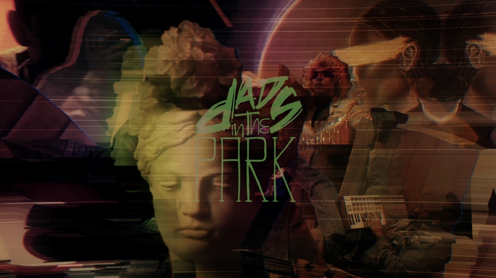

# 🎸 Dads In The Park

[](https://github.com/BD-Band-Archive/BD-Band-Music) [](#) [](#) [](#)

<p align="center">
  
</p>

## 🌟 About the Band

> **Dads In The Park** is an acclaimed Bangladeshi alternative and indie rock band formed in Dhaka. Known for their infectious melodic hooks, dynamic guitar arrangements, expressive introspective songwriting, and electrifying live synergy, the band quickly emerged as one of the most exciting young acts in Bangladesh's contemporary rock circuit.

---

## 📑 Discography Index

1. [The Platform Live (2022)](#1-the-platform-live-2022)
2. [88 New Paul Town (2026)](#2-88-new-paul-town-2026)
3. [Singles & Standalone Releases](#3-singles--standalone-releases)

---

<a id="1-the-platform-live-2022"></a>
## 1. The Platform Live (2022)

- **Artist:** Dads In The Park
- **Release Year:** 2022
- **Audio Quality:** Lossless FLAC (16-bit / 44.1 kHz)

<p align="center">
  
</p>

### 📖 About the Album
Recorded live for *The Platform Live (Season 1, Vol. 4)* in 2022, this electrifying live session captures Dads In The Park at the peak of their raw stage energy. Featuring stunning stripped-down and high-octane live performances of fan favorites including *"Afeenolove"*, *"Easy Baby"*, and *"Into the Iris"*.

### 🎵 Tracklist (One-Tap Download)

- [**01. Afeenolove (The Platform Live)**](https://media.githubusercontent.com/media/BD-Band-Archive/Dads-In-The-Park/master/The%20Platform%20Live%20%282022%29/Afeenolove%20-%20The%20Platform%20Live%2C%20Dads%20in%20the%20Park.flac?download=true) &nbsp; [](https://media.githubusercontent.com/media/BD-Band-Archive/Dads-In-The-Park/master/The%20Platform%20Live%20%282022%29/Afeenolove%20-%20The%20Platform%20Live%2C%20Dads%20in%20the%20Park.flac?download=true)
- [**02. Easy Baby (The Platform Live)**](https://media.githubusercontent.com/media/BD-Band-Archive/Dads-In-The-Park/master/The%20Platform%20Live%20%282022%29/Easy%20Baby%20-%20The%20Platform%20Live%2C%20Dads%20in%20the%20Park.flac?download=true) &nbsp; [](https://media.githubusercontent.com/media/BD-Band-Archive/Dads-In-The-Park/master/The%20Platform%20Live%20%282022%29/Easy%20Baby%20-%20The%20Platform%20Live%2C%20Dads%20in%20the%20Park.flac?download=true)
- [**03. Escape The Honour Kill (The Platform Live)**](https://media.githubusercontent.com/media/BD-Band-Archive/Dads-In-The-Park/master/The%20Platform%20Live%20%282022%29/Escape_The_Honour_Kill_The_Platform_Live%2C_Dads_in_the_Park.flac?download=true) &nbsp; [](https://media.githubusercontent.com/media/BD-Band-Archive/Dads-In-The-Park/master/The%20Platform%20Live%20%282022%29/Escape_The_Honour_Kill_The_Platform_Live%2C_Dads_in_the_Park.flac?download=true)
- [**04. Into the Iris (The Platform Live)**](https://media.githubusercontent.com/media/BD-Band-Archive/Dads-In-The-Park/master/The%20Platform%20Live%20%282022%29/Into%20the%20Iris%20-%20The%20Platform%20Live%2C%20Dads%20in%20the%20Park.flac?download=true) &nbsp; [](https://media.githubusercontent.com/media/BD-Band-Archive/Dads-In-The-Park/master/The%20Platform%20Live%20%282022%29/Into%20the%20Iris%20-%20The%20Platform%20Live%2C%20Dads%20in%20the%20Park.flac?download=true)
- [**05. Lullaby (The Platform Live)**](https://media.githubusercontent.com/media/BD-Band-Archive/Dads-In-The-Park/master/The%20Platform%20Live%20%282022%29/Lullaby%20-%20The%20Platform%20Live%2C%20Dads%20in%20the%20Park.flac?download=true) &nbsp; [](https://media.githubusercontent.com/media/BD-Band-Archive/Dads-In-The-Park/master/The%20Platform%20Live%20%282022%29/Lullaby%20-%20The%20Platform%20Live%2C%20Dads%20in%20the%20Park.flac?download=true)

### 🖼️ Album Artwork

| | |
| :---: | :---: |
| <br><sub><b>1. Front Cover</b></sub> |  |

---

<a id="2-88-new-paul-town-2026"></a>
## 2. 88 New Paul Town (2026)

- **Artist:** Dads In The Park
- **Release Year:** 2026
- **Audio Quality:** Lossless FLAC (16-bit / 44.1 kHz)

<p align="center">
  
</p>

### 📖 About the Album
*88 New Paul Town* represents Dads In The Park's studio progression, showcasing tight indie-rock rhythms, rich vocal harmonies, and nuanced guitar layers across tracks like *"Easy, baby!"*, *"Gutter"*, and *"Postrip"*.

### 🎵 Tracklist (One-Tap Download)

- [**01. Easy, baby!**](https://media.githubusercontent.com/media/BD-Band-Archive/Dads-In-The-Park/master/88%20New%20Paul%20Town%20%282026%29/Dads%20in%20the%20Park%20-%2001%20-%20Easy%2C%20baby%21.flac?download=true) &nbsp; [](https://media.githubusercontent.com/media/BD-Band-Archive/Dads-In-The-Park/master/88%20New%20Paul%20Town%20%282026%29/Dads%20in%20the%20Park%20-%2001%20-%20Easy%2C%20baby%21.flac?download=true)
- [**02. Gutter**](https://media.githubusercontent.com/media/BD-Band-Archive/Dads-In-The-Park/master/88%20New%20Paul%20Town%20%282026%29/Dads%20in%20the%20Park%20-%2002%20-%20Gutter.flac?download=true) &nbsp; [](https://media.githubusercontent.com/media/BD-Band-Archive/Dads-In-The-Park/master/88%20New%20Paul%20Town%20%282026%29/Dads%20in%20the%20Park%20-%2002%20-%20Gutter.flac?download=true)
- [**03. Postrip**](https://media.githubusercontent.com/media/BD-Band-Archive/Dads-In-The-Park/master/88%20New%20Paul%20Town%20%282026%29/Dads%20in%20the%20Park%20-%2003%20-%20Postrip.flac?download=true) &nbsp; [](https://media.githubusercontent.com/media/BD-Band-Archive/Dads-In-The-Park/master/88%20New%20Paul%20Town%20%282026%29/Dads%20in%20the%20Park%20-%2003%20-%20Postrip.flac?download=true)

### 🖼️ Album Artwork

| | |
| :---: | :---: |
| <br><sub><b>1. Front Cover</b></sub> |  |

---

<a id="3-singles--standalone-releases"></a>
## 3. Singles & Standalone Releases

- **Artist:** Dads In The Park
- **Release Year:** Standalone Releases
- **Audio Quality:** Lossless FLAC (16-bit / 44.1 kHz)

<p align="center">
  
</p>

### 📖 About the Album
A definitive collection of standalone studio singles released by Dads In The Park, featuring foundational breakthroughs including *"Afeenolove"*, *"Pareidolia"*, *"Lullaby"*, and *"Into the Iris"*.

### 🎵 Tracklist (One-Tap Download)

- [**01. Afeenolove**](https://media.githubusercontent.com/media/BD-Band-Archive/Dads-In-The-Park/master/Singles/Dads%20In%20The%20Park%20-%20Afeenolove.flac?download=true) &nbsp; [](https://media.githubusercontent.com/media/BD-Band-Archive/Dads-In-The-Park/master/Singles/Dads%20In%20The%20Park%20-%20Afeenolove.flac?download=true)
- [**02. Calamia**](https://media.githubusercontent.com/media/BD-Band-Archive/Dads-In-The-Park/master/Singles/Dads%20in%20the%20Park%20-%20Calamia.flac?download=true) &nbsp; [](https://media.githubusercontent.com/media/BD-Band-Archive/Dads-In-The-Park/master/Singles/Dads%20in%20the%20Park%20-%20Calamia.flac?download=true)
- [**03. Into the Iris**](https://media.githubusercontent.com/media/BD-Band-Archive/Dads-In-The-Park/master/Singles/Dads%20in%20the%20Park%20-%20Into%20the%20Iris.flac?download=true) &nbsp; [](https://media.githubusercontent.com/media/BD-Band-Archive/Dads-In-The-Park/master/Singles/Dads%20in%20the%20Park%20-%20Into%20the%20Iris.flac?download=true)
- [**04. Lullaby**](https://media.githubusercontent.com/media/BD-Band-Archive/Dads-In-The-Park/master/Singles/Dads%20In%20The%20Park%20-%20Lullaby.flac?download=true) &nbsp; [](https://media.githubusercontent.com/media/BD-Band-Archive/Dads-In-The-Park/master/Singles/Dads%20In%20The%20Park%20-%20Lullaby.flac?download=true)
- [**05. Pareidolia**](https://media.githubusercontent.com/media/BD-Band-Archive/Dads-In-The-Park/master/Singles/Dads%20In%20The%20Park%20-%20Pareidolia.flac?download=true) &nbsp; [](https://media.githubusercontent.com/media/BD-Band-Archive/Dads-In-The-Park/master/Singles/Dads%20In%20The%20Park%20-%20Pareidolia.flac?download=true)
- [**06. Remembrance**](https://media.githubusercontent.com/media/BD-Band-Archive/Dads-In-The-Park/master/Singles/Dads%20In%20The%20Park%20-%20Remembrance.flac?download=true) &nbsp; [](https://media.githubusercontent.com/media/BD-Band-Archive/Dads-In-The-Park/master/Singles/Dads%20In%20The%20Park%20-%20Remembrance.flac?download=true)
- [**07. Running on Empty**](https://media.githubusercontent.com/media/BD-Band-Archive/Dads-In-The-Park/master/Singles/Dads%20in%20the%20Park%20-%20running%20on%20empty.flac?download=true) &nbsp; [](https://media.githubusercontent.com/media/BD-Band-Archive/Dads-In-The-Park/master/Singles/Dads%20in%20the%20Park%20-%20running%20on%20empty.flac?download=true)

### 🖼️ Album Artwork

| | |
| :---: | :---: |
| <br><sub><b>1. Front Cover</b></sub> |  |

---

### 💾 Git LFS & Downloading Audio
All audio tracks in this repository are managed via **Git LFS** (Large File Storage).
- **One-Tap Direct Download:** Click either the track title or the green download button next to any song to instantly save the file to your device.
- **To clone locally with all audio files:**
  ```bash
  git lfs install
  git clone https://github.com/BD-Band-Archive/Dads-In-The-Park.git
  ```

---

### 🤝 Contribution & DMCA Notice
All songs and archival materials in this repository were collected and curated from various internet sources, physical CD rips, and public community archives for cultural preservation and historical documentation.

- **Contributions:** If you have physical CD or cassette rips in lossless FLAC format, missing booklet/inlay scans, or tracklist metadata corrections, contributions and pull requests are warmly welcome!
- **DMCA / Copyright Notice:** If this repository contains your copyrighted or DMCA-protected files and you wish to have them removed, please contact:
  - **Email:** [maniruzzamanmridul@gmail.com](mailto:maniruzzamanmridul@gmail.com)
  
  Please provide the specific track, album, or file details, and the requested material will be reviewed and removed as soon as possible.
